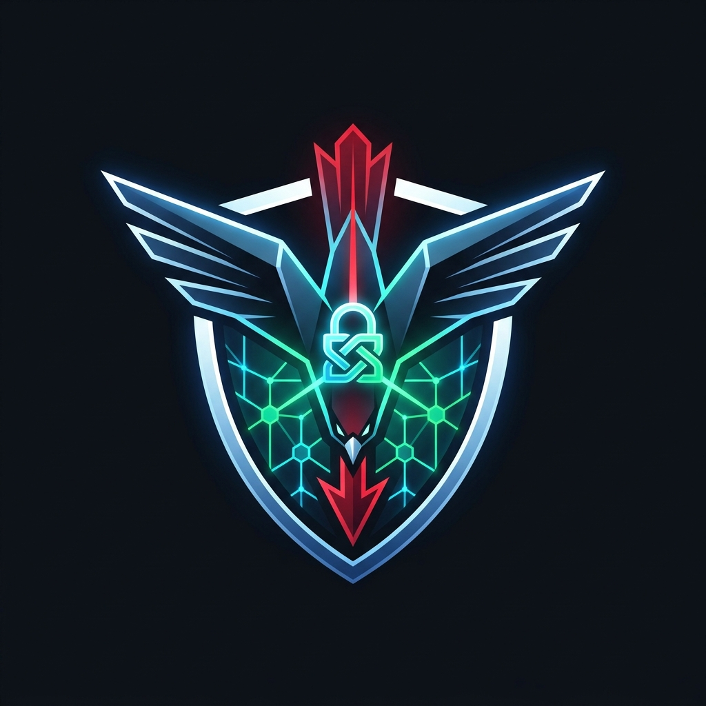

<p align="center">
  
</p>

<h1 align="center">FallLine</h1>

<p align="center">
  <b>Defensive Attack-Path Analysis & Choke-Point Verification Platform</b><br />
  <i>Find the shortest route an attacker can take, calculate Time-to-Compromise, and verify fixes by re-scanning.</i>
</p>

<p align="center">
  
  
  
  
  
  
  
  
</p>

---

## What is FallLine?

Defensive attack-path analysis and verification for systems **you own or are authorized to test**.

FallLine discovers real network, service, web, and cloud exposures, chains them into the cheapest attacker route, calculates a **time-to-compromise** estimate grounded in MITRE ATT&CK + CISA KEV / EPSS data, ranks choke-point fixes ("Fix This First"), and **verifies each fix by re-scanning only that specific item**.

## Authorized Use Only (Safety by Design)
- **Scope Guard & Ownership Verification**: FallLine refuses to scan any target not listed in `scope.yaml`. Private/loopback ranges require explicit authorization confirmation (`i_confirm_authorization: true`). Public IPs/CIDRs require cryptographic ownership proof (via HTTP `.well-known/fallline-verify.txt` token or DNS TXT record).
- **Detection Only**: Never exploits, never brute-forces passwords, and excludes all intrusive Nuclei tags (`intrusive`, `dos`, `fuzz`, `bruteforce`, `exploit`, `rce`, `sqli`, `xss`, etc.) both on the command line and at parse time.
- **Read-Only Cloud Audit (v2)**: The AWS configuration audit wraps `boto3` clients in `ReadOnlyClient`, blocking any call that does not start with `describe_`, `list_`, or `get_`.
- **Audit Log**: Every scan and verification check (allowed or refused) is recorded to `data/audit.log`.

## Features across Milestones (M1 – M5 + v2 + v3)
- **M1  Scope Guard & Pluggable Scanners**: `scope.py` + adapters for `nmap` (`-sV`), `naabu`, `httpx` (ProjectDiscovery), `nuclei` (safe `exposure`/`misconfig` templates only), and a pure-Python `socket` fallback.
- **M2  Rules Knowledge Base, Threat Intel & Attack-Path Engine**:
  - `fallline/rules/rules.yaml`: Maps findings to MITRE ATT&CK techniques, attacker effort minutes, fix effort minutes, plain-language remediation, and copy-ready remediation commands (`fix_command`).
  - `fallline/intel.py`: CISA Known Exploited Vulnerabilities (KEV) and FIRST EPSS loader with local caching (`data/intel_cache.json`) and graceful offline fallback.
  - `fallline/paths.py`: Directed multigraph engine (`networkx` / Dijkstra) computing shortest path from `ATTACKER` to `GOAL`, time-to-compromise (`external` and `internal` perspectives), and greedy choke-point fix ranking.
- **M3  SQLite Store, Verification Loop & Web Dashboard**:
  - `fallline/store.py` & `fallline/verify.py`: Tracks `OPEN`, `FIXED_VERIFIED`, and `ACCEPTED_RISK`. Re-scans only the single fixed port/check; inconclusive probes (host down / timeout) never mark a finding fixed.
  - `fallline/app.py` & `fallline/web/`: FastAPI dashboard with animated HTML5 canvas dominoes, live time-to-compromise, before/after comparison, target scope & public ownership verification controls, and clearly labeled What-If Simulation mode.
- **M4  Full Pipeline Integration**: End-to-end discovery + web profiling (`httpx`) + safe `nuclei` checks + KEV/EPSS effort scaling.
- **M5  Plain-Language HTML & PDF "Attack Story" Reports**: Self-contained HTML and zero-dependency PDF report generation (`fallline/report.py`).
- **v2  Read-Only AWS Configuration Audit**: Checks EC2 security groups for world-open admin ports, public S3 buckets (Block Public Access, ACLs, policies), root MFA, and stale IAM access keys (`fallline/aws_audit.py`).
- **v3  Platform Upgrades**:
  - **MITRE ATT&CK Tactic Matrix & Copy-Ready Playbooks**: 9-phase MITRE ATT&CK coverage summary (`Initial Access` through `Impact`) across API (`/api/mitre`), CLI (`fallline mitre`), and Dashboard, plus one-click copy-ready defensive remediation commands (`ufw`, `systemctl`, `sshd_config`, `aws ec2`/`s3api`/`iam`) for every rule.
  - **Assessment Snapshots & History Diffing**: Point-in-time SQLite snapshots (`fallline snapshot save|list|diff` & `/api/snapshots/diff`) comparing `+ new` findings, `- fixed` verified findings, `accepted` risks, External/Internal Time-to-Compromise deltas, and Domino chain length changes (auto-seeded in `--demo` mode).
  - **Enterprise Security Exports (SARIF 2.1.0 + CSV)**: Export findings in SARIF 2.1.0 (`.sarif`) for GitHub Code Scanning / VS Code SARIF Viewer and CSV (`.csv`) for Jira / ServiceNow / spreadsheet tracking.
  - **Authorized Live Subnet Host Discovery**: Scope-checked host discovery (`fallline discover <cidr>` & `/api/discover`) with one-click **Scan Host** workflow in the dashboard.

## Quickstart

```bash
pip install -r requirements.txt
cp scope.example.yaml scope.yaml     # edit authorized_by and targets
```

### 1. Run the interactive web dashboard (Demo Mode — fake network, safe anywhere)
```bash
python -m fallline serve --demo
# Open http://127.0.0.1:8000
```

### 2. Discover active hosts & scan an authorized lab target from the CLI
```bash
python -m fallline discover 192.168.56.0/24 --scope scope.yaml
python -m fallline scan --scope scope.yaml --target 192.168.56.101
python -m fallline paths --perspective external
python -m fallline mitre
```

### 3. Save & diff assessment snapshots (Before vs. After)
```bash
python -m fallline snapshot save --name "Before Patching"
python -m fallline snapshot list
python -m fallline snapshot diff --base 1
```

### 4. Update CISA KEV + EPSS threat intelligence (cached locally)
```bash
python -m fallline intel-update
```

### 5. Verify a fix (re-scans only that single port/check)
```bash
python -m fallline verify --scope scope.yaml --key "192.168.56.101|21/tcp|vsftpd-234-backdoor"
```

### 6. Export HTML, PDF, SARIF 2.1.0, or CSV reports
```bash
python -m fallline report --scope scope.yaml --output data/report.html
python -m fallline report --scope scope.yaml --output data/report.pdf --pdf
python -m fallline report --scope scope.yaml --format sarif --output data/report.sarif
python -m fallline report --scope scope.yaml --format csv --output data/report.csv
```

### 7. Run v2 read-only AWS configuration audit
```bash
python -m fallline aws-audit --profile my-sandbox-readonly --region us-east-1
```

## Automated Tests & Linting
All automated tests use a mocked/fake network (`FakeToolkit`) and never touch real systems:
```bash
python -m pytest -q
python -m ruff check .
```

